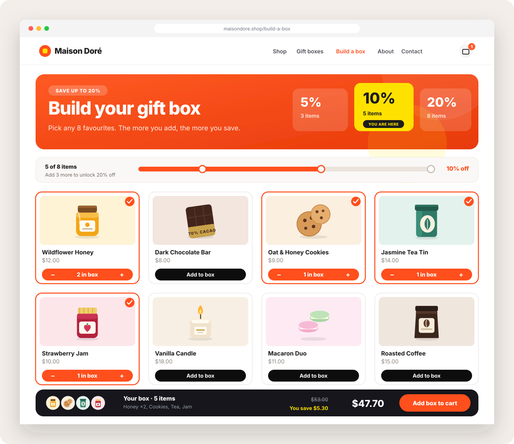
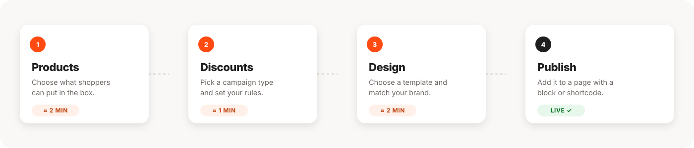
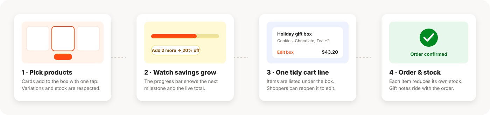

# Welcome to ProductBoxes

**ProductBoxes** turns a static product bundle into a guided, build-your-own-box experience. Shoppers pick products from a grid, watch their discount grow in real time, and add the finished box to the cart in one click.

Sell gift boxes, snack boxes, capsule wardrobes, beauty kits, samplers and hampers, with no code and no add-on fees.


**100% free.** Every feature is included. No premium tier, no subscription, no account, and no external services. Fonts and scripts are bundled locally.


# Productboxs-Doc

## Start here



### 🚀 Quick start

Go from install to a live box in about five minutes.


[quick-start.md](getting-started/quick-start.md)




### 🎯 Pick a campaign type

Tiered discount, fixed box size, or a bundle price. Learn which one fits your offer.


[campaign-types.md](guides/campaign-types.md)




### 🎨 Make it yours

Ten responsive templates, your colours and fonts, previewed live inside your theme.


[design-and-templates.md](guides/design-and-templates.md)




## See it in action

<figure><figcaption>
The Spotlight template: pick products, watch the discount tier climb, add the box to the cart. Shown with a demo gourmet gift store.
</figcaption></figure>

## How it works

<figure><figcaption>
Every box is built in the same four steps.
</figcaption></figure>

## What shoppers see

<figure><figcaption>
From the first tap to a confirmed order.
</figcaption></figure>

## Why stores choose ProductBoxes

| | |
| --- | --- |
| 📈 **Higher order value** | Tiered discounts and "buy more, save more" milestones encourage bigger carts. |
| 🎁 **Guided gift boxes** | Optional gift wrap and a personal gift message, all in the same flow. |
| 🧩 **Simple and variable** | Mix simple products and individual variations in one box. |
| 🛒 **Works with WooCommerce** | Classic and block Cart and Checkout, HPOS, and WooPayments Multi-Currency. |
| 🔒 **Private by design** | No CDN, no telemetry, no license checks. Analytics stay in your database. |
| ⚡ **Fast to set up** | A guided editor with a live, theme-aware preview on desktop, tablet and mobile. |

## Requirements

* WordPress 6.6 or later
* WooCommerce 9.0 or later
* PHP 7.4 or later


Not sure about your versions? ProductBoxes checks them on activation and tells you if something needs an update.


## Try the live demos

* [Explore ProductBoxes](https://bestwebexpert.com/productboxes/): the full feature tour
* [Capsule wardrobe box](https://bestwebexpert.com/capsule-wardrobe-box/): watch the discount grow
* [Gift box builder](https://bestwebexpert.com/gift-box-builder/): wrap and a gift message
* [Shirt bundle](https://bestwebexpert.com/shirt-bundle/): pick any 3 for one price


[demos.md](demos.md)


## Get help

* **Live chat support** and **hire an expert**: [bestwebexpert.com](https://bestwebexpert.com/)
* Support forum: [wordpress.org](https://wordpress.org/support/plugin/productboxes-mix-and-match-box-builder/)


[support.md](support.md)


<!-- cta -->
---


**Need help or want it done for you?**

💬 [Chat with live support](https://bestwebexpert.com/) · 🧑‍💻 [Hire an expert](https://bestwebexpert.com/) · 🎮 [Try the live demos](demos.md) · 📚 [All support options](support.md)

