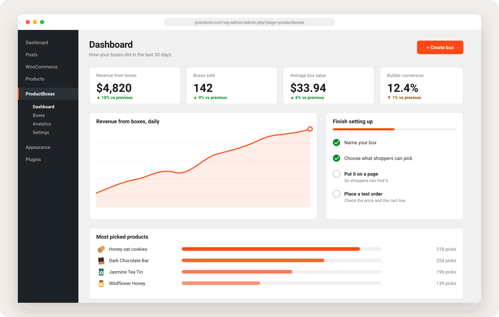

# A tour of the admin

ProductBoxes adds one menu to WordPress with four screens.

<figure><figcaption>
The Dashboard: key numbers, revenue, setup checklist and most-picked products.
</figcaption></figure>

| Screen | What it is for |
| --- | --- |
| **Dashboard** | Key numbers for the last 7, 30 or 90 days, a daily revenue chart, your most picked products, and the setup checklist. |
| **Boxes** | Every campaign in one searchable list, with status, placement links and a row menu to edit, duplicate or trash. |
| **Analytics** | Box views, product picks, conversion, revenue and discounts, with a previous-period comparison and CSV export. |
| **Settings** | Store-wide options for cart display, stock, coupons, analytics and data. |

## The Dashboard

* **Key numbers** show revenue from boxes, boxes sold, average box value and builder conversion, each compared with the previous period.
* **Finish setting up** guides you through your first box and hides once you are done. You can also hide it yourself.
* **Most picked products** shows what shoppers add to boxes most.

## The Boxes list

Use search to find a box fast. Each row has a status badge (Draft or Published), a thumbnail strip of its products, and a menu for actions. Deleted boxes go to the trash first, so you can restore them.

## The editor

Opening or creating a box takes you to the editor: **Products → Discounts → Design → Publish**, with a live preview of your storefront beside the controls.


[products.md](../guides/products.md)


<!-- cta -->
---


**Need help or want it done for you?**

💬 [Chat with live support](https://bestwebexpert.com/) · 🧑‍💻 [Hire an expert](https://bestwebexpert.com/) · 🎮 [Try the live demos](../demos.md) · 📚 [All support options](../support.md)

