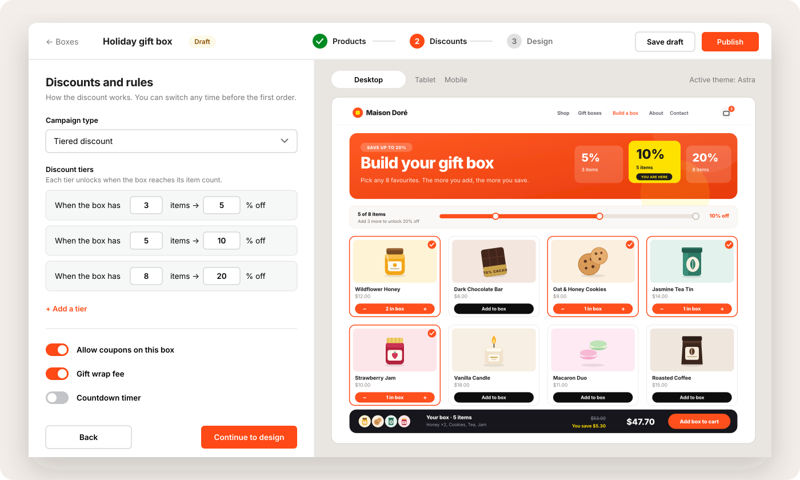

# Quick start: your first box

This walkthrough creates a **"Pick any 3"** bundle and puts it on a page.

<figure><figcaption>
The editor on the left, your real storefront on the right.
</figcaption></figure>



### Create the box

Go to **ProductBoxes → Boxes** and click **Create box**. Give it a name. The name is for you only, shoppers never see it.



### Choose the products

On **Products**, search by name or SKU and tick what can go in the box, or choose a whole category or tag. Picked products show under **Picked**.


Drag picked products to set the order shoppers see them in.




### Set the offer

Click **Continue to discounts** and choose a campaign type. For this tutorial pick **Bundle price**, set **Items in the bundle** to `3` and enter your price.



### Pick a look

Click **Continue to design**, choose a template, and adjust colours if you like. Switch the preview between **Desktop**, **Tablet** and **Mobile** as you go.



### Publish

Click **Continue to publish**. Choose where shoppers should find the box:

* **Create a new page**: ProductBoxes makes the page and adds the box.
* **Add to a page I have**: pick an existing page and it goes at the top.
* **I'll place it myself**: use the block or the shortcode.

Then click **Publish**.



### Place a test order

Open the page, build a box, add it to the cart and check out. Confirm the price and the cart line look right.




The **Dashboard** keeps a **Finish setting up** checklist: name it, choose products, put it on a page, place a test order. Tick them off and it hides itself.


## Where to go next


[campaign-types.md](../guides/campaign-types.md)



[design-and-templates.md](../guides/design-and-templates.md)


<!-- cta -->
---


**Need help or want it done for you?**

💬 [Chat with live support](https://bestwebexpert.com/) · 🧑‍💻 [Hire an expert](https://bestwebexpert.com/) · 🎮 [Try the live demos](../demos.md) · 📚 [All support options](../support.md)

