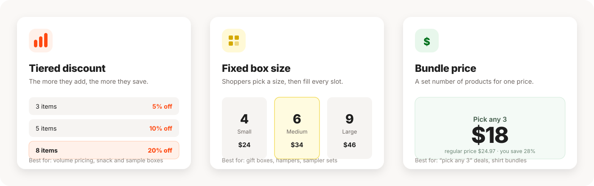

# Choose a campaign type

Every box uses one of three campaign types. You set it on the **Discounts** step, and you can switch any time before the first order.

<figure><figcaption>
Three ways to reward a fuller box.
</figcaption></figure>



**The more they add, the more they save.**

You define tiers, each unlocking at an item count. As shoppers fill the box, the discount steps up and the progress bar shows how far the next tier is.

| When the box has | Discount |
| --- | --- |
| 3 items | 5% off |
| 5 items | 10% off |
| 8 items | 20% off |

Discounts can be a **percent** or a **fixed amount**.

**Great for:** volume pricing, snack and sample boxes, "buy more, save more" promotions.



**Shoppers pick a size, then fill every slot.**

Create sizes such as Small, Medium and Large, each with its own item count and price or discount. The builder shows the matching number of slots and keeps the checkout button locked until the box is full.

**Great for:** gift boxes, hampers, sampler sets, anything with a defined container.



**A set number of products for one price.**

Choose **Items in the bundle** and a **Bundle price**. Shoppers pick any eligible products and pay that one price.

> *Pick any 3 for $18*

**Great for:** "pick any 3" shirt bundles, product sets, introductory offers.



## Which should I use?

| If you want to… | Use |
| --- | --- |
| Encourage bigger baskets with rising rewards | **Tiered discount** |
| Sell a defined container with set capacity | **Fixed box size** |
| Advertise one simple price for N items | **Bundle price** |


Not sure? Start with **Tiered discount**. It is the most forgiving, and the live progress bar nudges shoppers to add one more item.



[discounts-and-rules.md](discounts-and-rules.md)


<!-- cta -->
---


**Need help or want it done for you?**

💬 [Chat with live support](https://bestwebexpert.com/) · 🧑‍💻 [Hire an expert](https://bestwebexpert.com/) · 🎮 [Try the live demos](../demos.md) · 📚 [All support options](../support.md)

