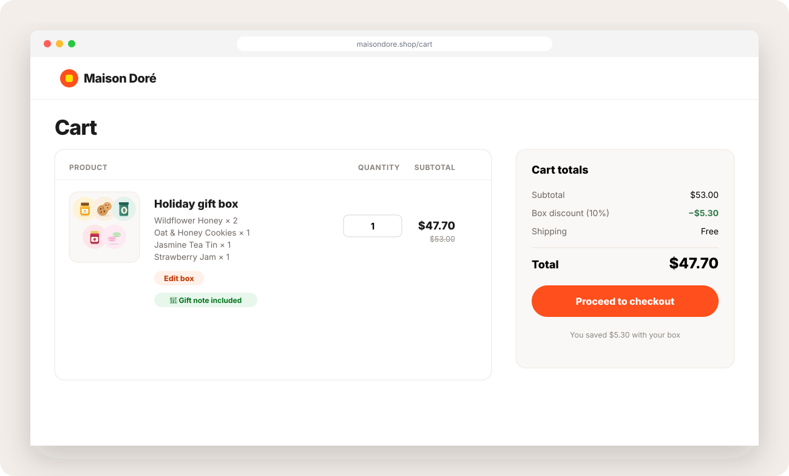

# Cart, checkout and orders

## In the cart

<figure><figcaption>
One tidy cart line, an <strong>Edit box</strong> link and the discount in the totals.
</figcaption></figure>

A box is added as **one cart line** with its price and the items listed under it. Control the display in **Settings → Cart and checkout**:

| Setting | Effect |
| --- | --- |
| **Show a box in the cart as** | A box name and price with items listed under it, or every item on its own line, grouped. |
| **Shoppers can edit a box from the cart** | Adds an **Edit box** link that reopens the builder. |
| **Main box page** | The page that **Edit box** links open. |
| **Allow coupons on boxes** | Off by default, so coupons do not stack on box discounts. |

## At checkout

ProductBoxes supports both the **classic** cart and checkout and the **WooCommerce Cart and Checkout blocks**, including box details, discounts and gift messages.

## On the order

| Setting | Effect |
| --- | --- |
| **List the items in each box** | Shows items in order confirmations and invoices. |
| **Include the gift note** | Includes the note in your new-order email only. |
| **Reduce stock for each item** | Keeps WooCommerce stock counts right. Each item inside the box reduces its own stock. |


Orders are never touched when you delete or reset ProductBoxes data.



[analytics.md](analytics.md)


<!-- cta -->
---


**Need help or want it done for you?**

💬 [Chat with live support](https://bestwebexpert.com/) · 🧑‍💻 [Hire an expert](https://bestwebexpert.com/) · 🎮 [Try the live demos](../demos.md) · 📚 [All support options](../support.md)

