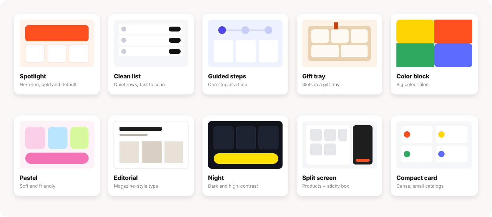
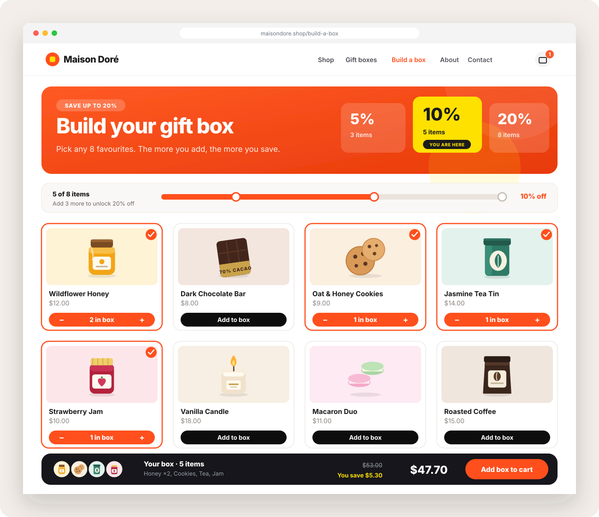
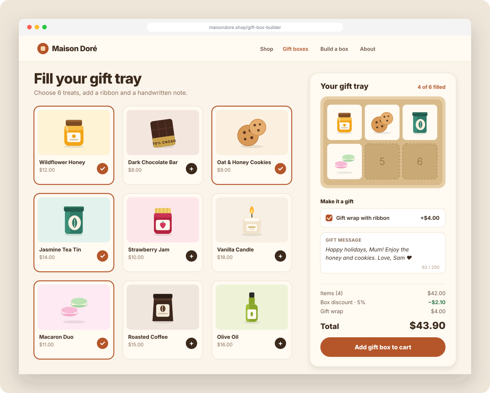
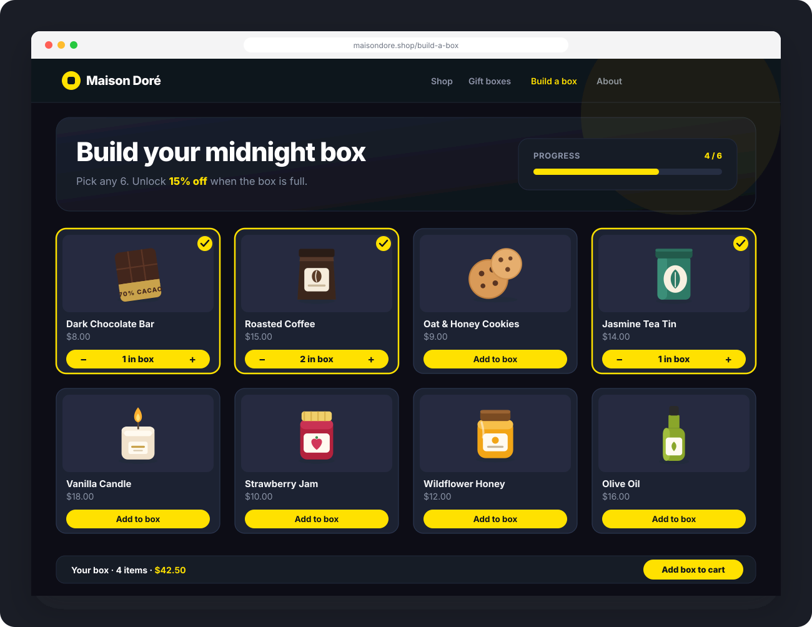
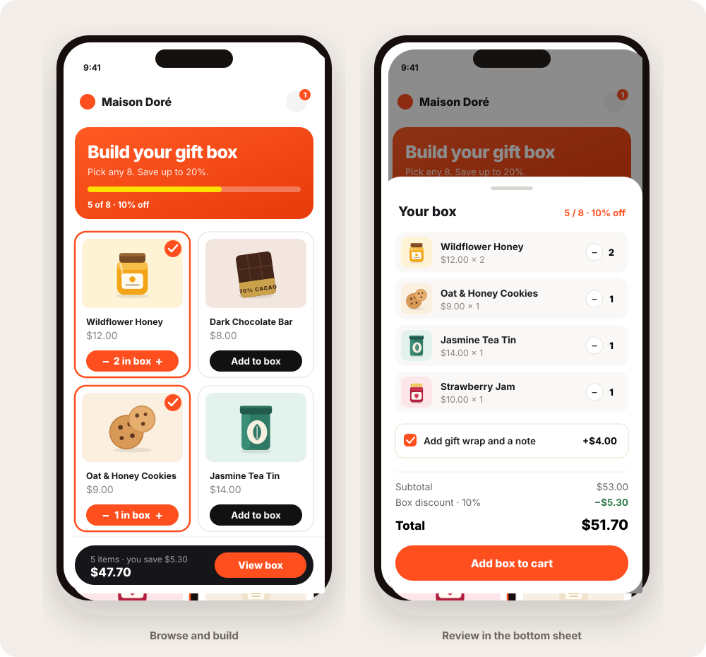

# Design and templates

The **Design** step controls how the builder looks. Everything you change updates the live preview immediately.

## Ten templates

<figure><figcaption>
Pick a starting look. Your style settings stay when you switch.
</figcaption></figure>

| Template | Feel |
| --- | --- |
| **Spotlight** | Bold hero, the default |
| **Clean list** | Quiet rows, easy to scan |
| **Guided steps** | One step at a time |
| **Gift tray** | Products drop into tray slots |
| **Color block** | Big colour tiles |
| **Pastel** | Soft and friendly |
| **Editorial** | Magazine-style type |
| **Night** | Dark and high-contrast |
| **Split screen** | Products beside a sticky box summary |
| **Compact card** | Dense, ideal for small catalogs |

### Templates up close



<figure><figcaption>
Bold hero, discount tiers up top and a sticky box summary.
</figcaption></figure>



<figure><figcaption>
Products drop into a tray, with gift wrap and a handwritten message.
</figcaption></figure>



<figure><figcaption>
Dark and high-contrast, great for bold brands.
</figcaption></figure>



## What you can customise



Accent and main button, background, secondary text, and the colours used for savings and the sale badge.

Turn on **Match my site** (also called **Keep in sync with my theme**) to use your theme's colours, fonts and button shape. They update when you change your theme.



Choose a **Heading font** and **Body font** from bundled local fonts (Bricolage Grotesque, DM Sans, Figtree, Fraunces, Inter Tight, Plus Jakarta Sans, Space Grotesk) or your system font, plus the **Heading weight**.



**Products per row**, **Padding**, **Full width**, **Card corner radius**, **Card shadow**, **Image shape and fit**, and whether the summary sits in a panel or a **bottom bar**.



Headline, short intro, button text and the labels around the box. Leave a field empty to use the translated default text.



An **Extra CSS class** and **Custom CSS** that applies only to this box.



## Live preview

Preview inside your **active theme** on **Desktop**, **Tablet** and **Mobile**, or open it in a new tab. What you see is what shoppers get.


Made a mess? Use **Reset style to template defaults** to go back, without losing the box's products or discounts.


## Mobile

Every template is responsive. On phones the summary becomes a **sticky bar** and a **bottom sheet** so the cart is always one tap away.

<figure><figcaption>
Browse with a sticky summary, then review the box in the bottom sheet.
</figcaption></figure>


[publishing.md](publishing.md)


<!-- cta -->
---


**Need help or want it done for you?**

💬 [Chat with live support](https://bestwebexpert.com/) · 🧑‍💻 [Hire an expert](https://bestwebexpert.com/) · 🎮 [Try the live demos](../demos.md) · 📚 [All support options](../support.md)

