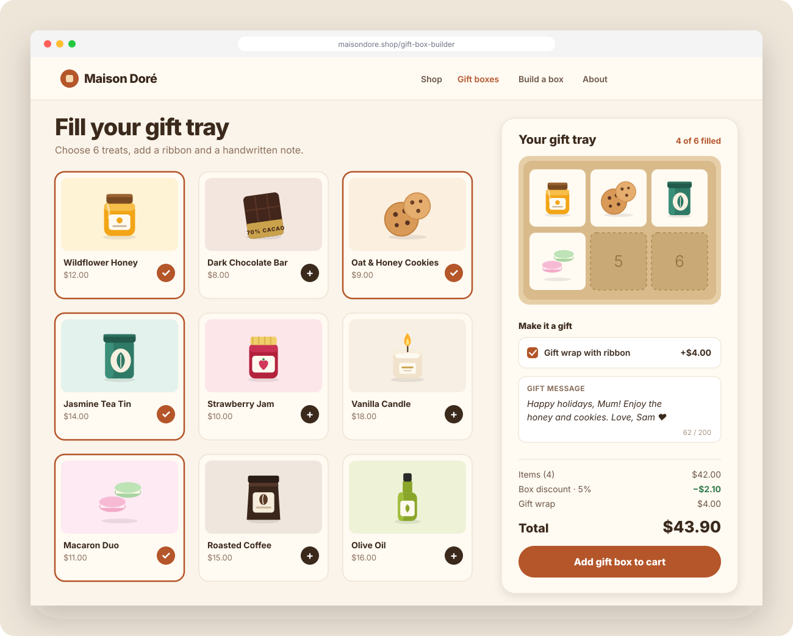

# Gift boxes

Any box can become a gift box. On the **Discounts** step you can add two optional extras.

| Option | What it does |
| --- | --- |
| **Gift wrap fee** | An optional paid add-on shoppers tick at the builder. |
| **Gift message** | A text box under the box summary, printed on the packing slip. |

<figure><figcaption>
The Gift tray template with gift wrap and a personal message.
</figcaption></figure>

## Where the message goes

* It is stored with the **WooCommerce order item**.
* You see it in your **new-order email** only, never in the customer's. This is controlled by **Include the gift note** in [Settings](../reference/settings.md).
* It is included in WordPress **personal data export and erasure** tools.

## Free gift product

You can also add a **free gift**: a product at no charge once the box reaches a set number of items. It goes in the cart with the box.


Pair the **Gift tray** template with a **Fixed box size** campaign for a classic hamper experience.



[cart-checkout-orders.md](cart-checkout-orders.md)


<!-- cta -->
---


**Need help or want it done for you?**

💬 [Chat with live support](https://bestwebexpert.com/) · 🧑‍💻 [Hire an expert](https://bestwebexpert.com/) · 🎮 [Try the live demos](../demos.md) · 📚 [All support options](../support.md)

