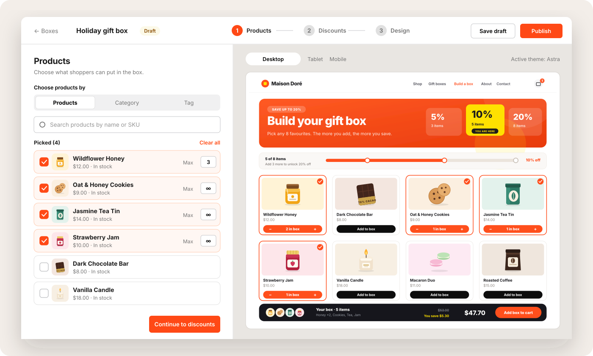

# Select products

The **Products** step controls what can go in the box and how it is ordered.

<figure><figcaption>
Tick products on the left and see them appear in the live preview on the right.
</figcaption></figure>

## Choose products by

| Method | How it works |
| --- | --- |
| **All products / by hand** | Search by name or SKU and tick products one by one. Simple products and individual variations are supported, so shoppers can mix sizes, colours and flavours. |
| **Category** | Pick one or more categories. Every simple product in them can go in the box. |
| **Tag** | Same idea, using product tags. |


Categories and tags **follow your store**. New products added to those terms appear in the box on their own. Variable products are left out of category and tag selections. To offer variations, pick them by hand.


## Order and limits

* **Drag to reorder** the picked products, or use the arrows. Shoppers see them in that order.
* Set a **Max per box** cap on a product to limit how many of that one product fit in a box.
* Use **Clear all** to start the selection again.

## Stock

Out-of-stock products are handled for you. By default they show as **Sold out** and cannot be added. Turn on **Hide sold-out products** to remove them from the grid entirely. Low stock can show as **Only N left**.

## Show more

Large catalogs load in pages. Shoppers use **Show more** to reveal the rest.


[discounts-and-rules.md](discounts-and-rules.md)


<!-- cta -->
---


**Need help or want it done for you?**

💬 [Chat with live support](https://bestwebexpert.com/) · 🧑‍💻 [Hire an expert](https://bestwebexpert.com/) · 🎮 [Try the live demos](../demos.md) · 📚 [All support options](../support.md)

